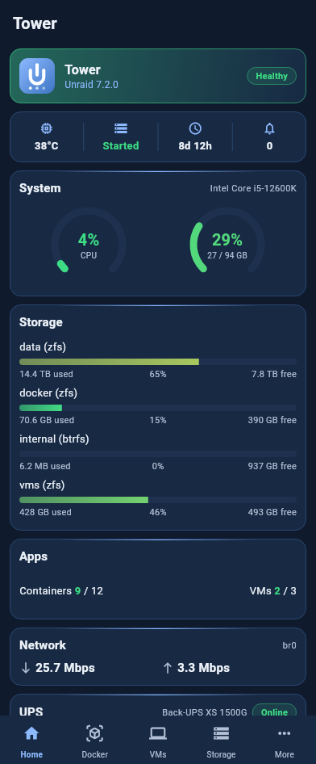
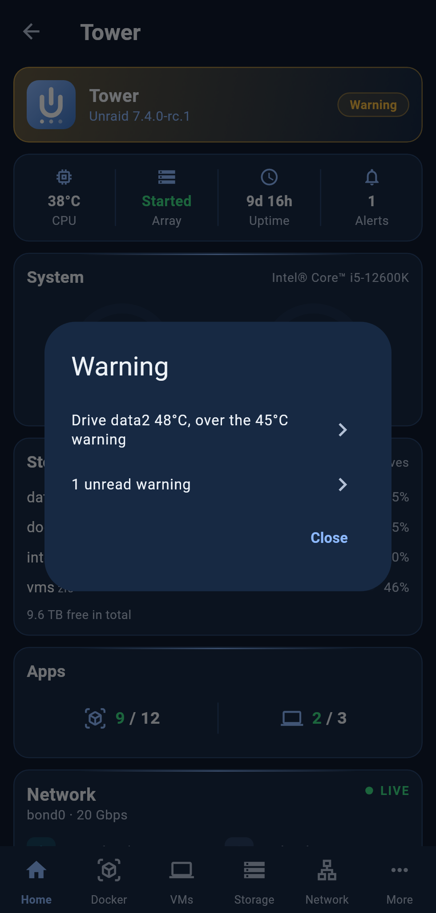
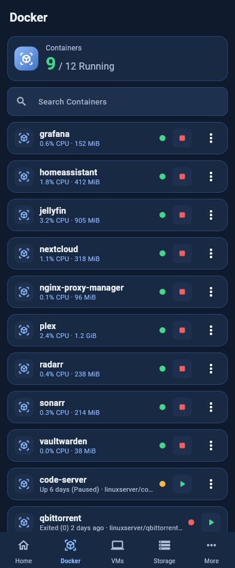
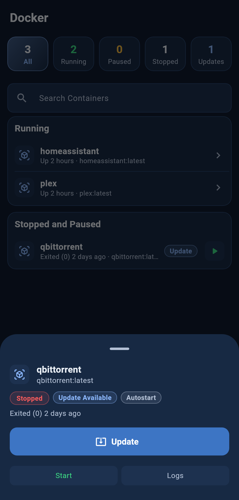
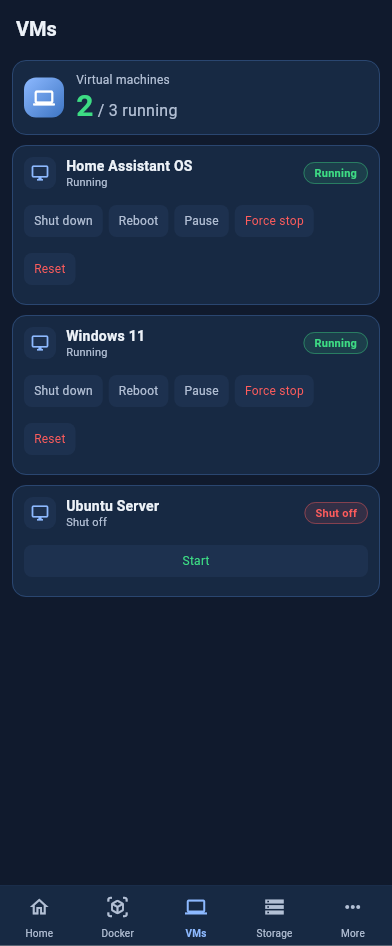
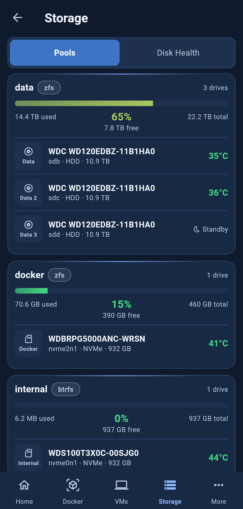
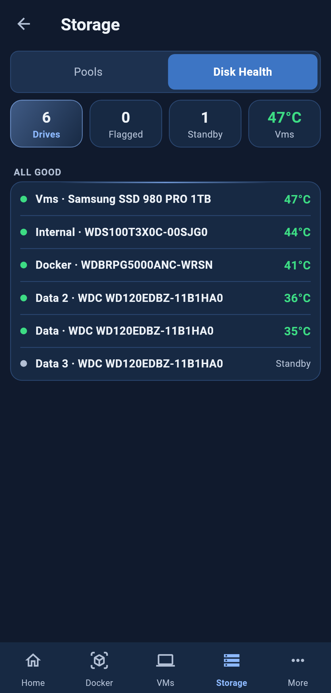
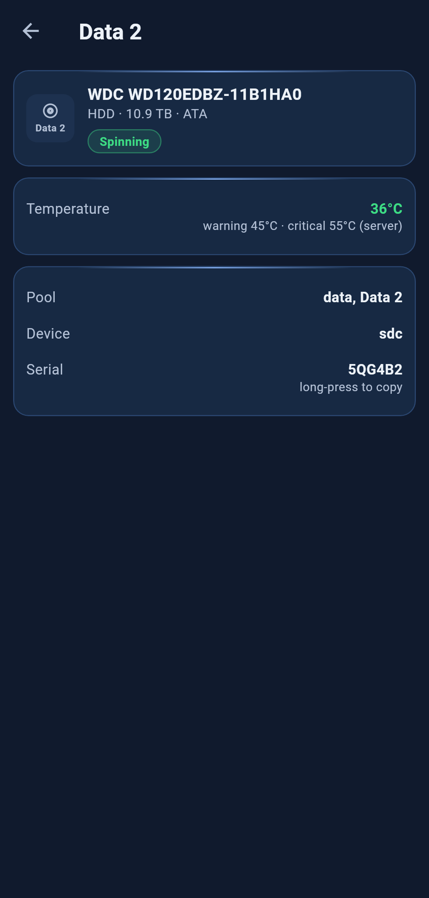
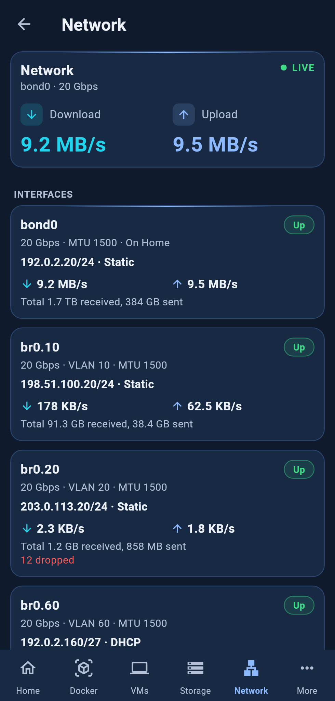
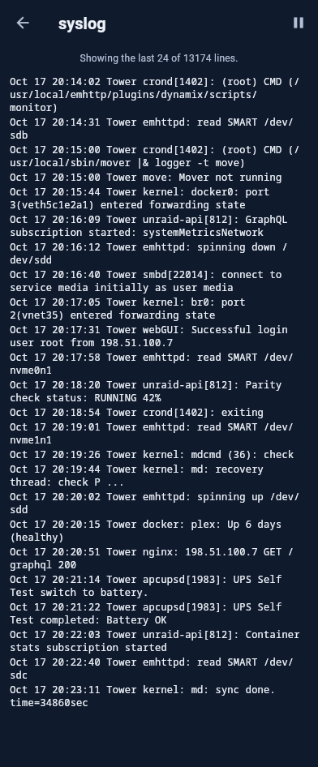

# urrt

An Android remote for Unraid servers: server health at a glance (a green, amber or red card that takes you to whatever needs attention), Docker containers you can filter, start, stop and update, VMs you can filter, start and stop, storage by pool with every drive's model and temperature, a Disk Health view that puts problem drives first, a page per drive, parity checks, live network speeds, a UPS card, the server's and containers' logs (which you can share, for example by email), and notifications. It uses your own server's official Unraid API: no account, no cloud relay, no tracking.

This repository holds signed release builds only.

<p>










</p>

Screenshots show a demo server.

## Install

1. On your Android phone, open the latest release: **https://github.com/guyp2k/urrt-releases/releases/latest** and download `urrt-<version>.apk`.
2. Open the file. Android asks you to allow installs from your browser or file manager the first time. Allow it, then install.
3. Open urrt, tap **Add server**, and enter your Unraid server's address. Use **Sign in with Unraid**, or paste an API key from the webGUI (Settings > Management Access > API Keys).

Requirements: Android 7.0 or newer; Unraid 7.2 or newer (the API is built in).

## Check the download (optional)

Every release is signed with the same key. Its certificate's SHA-256 fingerprint is:

```
A4:5F:81:A9:9E:85:14:A4:14:EE:91:7B:AD:19:CC:64:A7:22:D1:89:8A:2F:5B:5B:55:3A:CB:A1:B8:D4:7A:19
```

With the Android SDK: `apksigner verify --print-certs urrt-<version>.apk`. The `SHA-256 digest` line must match. Each release also lists the APK's SHA-256 checksum.

## Privacy

- urrt connects to the Unraid servers you add and to the hosts that container icons point to. It has no account, cloud relay, analytics, crash reporting or ads.
- Each server's API key, address and pinned certificate are kept in Android's encrypted storage on your phone and sent only to that server.
- Container icons load from wherever each container's template points (usually GitHub). Those hosts see your phone's IP address and which icons it asks for.
- **Sharing logs** hands the log text to the app you pick in Android's share sheet; nothing is sent until you pick one. The message names the server and the container or log file, and logs can contain addresses, paths or tokens that containers print, so read a log before you share it.
- With app lock on, urrt hides its screen from the recent-apps view.

## Good to know

- **Health card:** the server card on Home is green when all is well, amber for warnings (stale data, a stopped or rebuilding array, disk errors, hot drives, unread warnings, UPS on battery) and red for problems (array fault, disabled or missing disk, a drive at its limit, unread alerts, UPS low battery). It has no colour when urrt cannot read enough to judge. Tap it to go where the reason is handled: Notifications for unread alerts and warnings (archive them there), Disk Health for disks and drive temperatures, Pools for the array.
- **Filters:** on Docker, VMs and Disk Health the count tiles at the top are the filters. Tap one to show only those, All (Drives on Disk Health) to show everything. The fourth Disk Health tile names the drive to watch: one over its warning or limit first, otherwise the hottest. Tap it to open that drive's page.
- **Container updates:** when the server reports a newer image, the container's sheet has an Update button. Unraid pulls the image and recreates the container, as the webGUI's update link does: a running container starts again, a stopped one stays stopped. urrt then checks and says whether it really updated. Large images can take a few minutes; keep the app open until it reports.
- **Sharing logs:** Share, next to Pause on a container's logs and on each server log, sends the lines loaded on screen to any app, for example Gmail. The message starts with what it holds and when it was read, such as "Last 200 lines of the plex log on Tower, as of 2026-10-19 10:02:03." or "Lines 13151 to 13174 of 13174 in syslog on Tower". It is the lines on screen, not the whole file.
- **Retry:** when the server can't be reached, Retry shows "Retrying" and then when it failed, for example "Retry at 09:45:12 failed", so you can tell each tap was tried.
- **Drive details:** each drive's model and serial come from the disk id Unraid already reports, so opening a drive never wakes it. Firmware and SMART are not shown: the API reads them by querying every drive with smartctl, which would spin up sleeping disks.
- **UPS card:** shown only when the UPS is set up in Unraid's UPS Settings (apcupsd). The Unraid API does not report a UPS monitored through the NUT plugin (requested upstream: https://github.com/unraid/api/issues/2115).
- **Parity controls:** Check, Check and Correct, Pause, Resume and Cancel appear only on arrays with a parity disk. They have been tested against the API's replies but not yet on a real array, so use them with care.
- **VM Shut down:** Unraid asks the guest to shut down, waits about 10 seconds, then cuts power. Shut down slow guests (Windows, Home Assistant OS mid-update) from inside the VM.
